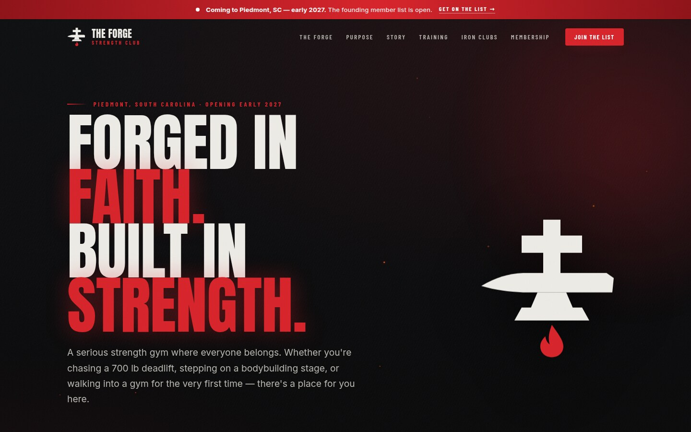

# The Forge Strength Club

Source for [anthonyradke.github.io/theforge-web](https://anthonyradke.github.io/theforge-web/), the website of The
Forge Strength Club, a strength gym opening in Piedmont, South Carolina in early 2027.

<p align="center">
  
</p>

## Stack

A single page of hand-written HTML, CSS and JavaScript with no framework or build step, served by GitHub Pages.
Pushing to `main` deploys. Static hosting keeps the running cost at zero, and the owner can change text by editing
one HTML file.

## How it works

- Colors and fonts (Anton, Barlow Condensed, Inter) are CSS custom properties at the top of `styles.css`.
- The logo is an inline SVG drawn to match the gym's logo, defined once in `index.html` and reused in the header
  and footer with `<use>`.
- Search and sharing: schema.org `ExerciseGym` structured data (JSON-LD), Open Graph tags, a sitemap and a web
  manifest.
- All content is readable with JavaScript disabled, and animations are disabled under `prefers-reduced-motion`.

### Contact form

GitHub Pages can't process form submissions. With a [Formspree](https://formspree.io) endpoint set in `CONFIG` at
the top of `main.js`, the form posts to it. Without one, the form opens a prefilled `mailto:` link. A hidden
honeypot field filters most bots.

### Mobile fixes

Found while testing on phones:

- Form fields stay at 16px on small screens, because iOS Safari zooms the page on focus below that.
- Opening the menu locks background scrolling without `position: fixed`, which would reset the scroll position.
- The sticky header is opaque on phones. `backdrop-filter` flickered while scrolling.
- The grain overlay is disabled on phones. It shifted when the browser toolbar showed or hid.

## Layout

| Path | Contents |
|---|---|
| `index.html` | Every section of the site |
| `assets/css/styles.css` | Styles |
| `assets/js/main.js` | Menu, scroll effects, counters, founder photo carousel, contact form |
| `assets/img/` | Logo, icons, link preview image, founder photos |

## Running locally

```sh
python3 -m http.server 4321
```

## Status

Pre-launch. Photos, the contact email, social links, pricing, hours, address and opening date are placeholders
until the gym supplies them. The link preview image is SVG only, which some sites don't render; a PNG version is
still to be added.

## License

The code (HTML, CSS and JavaScript) is MIT licensed. The Forge Strength Club's name, logo and content belong to
the gym. See [LICENSE](LICENSE).
